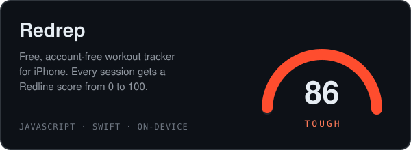
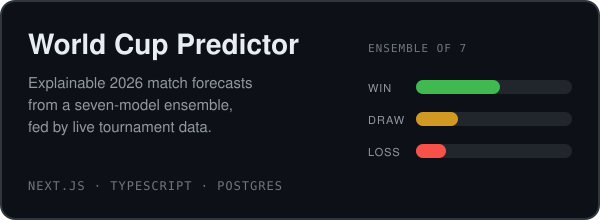
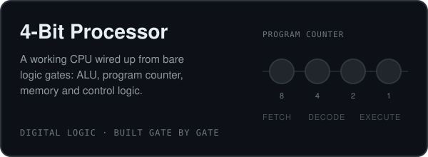

I'm Riad. I study computer science at the University of Michigan–Dearborn and spend the rest of my time shipping things: phone apps, prediction models, and lately a firewall that stops AI agents from setting 3D printers on fire.

I like projects where software touches something physical or has to explain itself. I speak four human languages and a few more that compile.

## On the bed right now

<p align="center">
  <a href="https://github.com/Ri4dH/GcodeGuard"></a>
  <a href="https://github.com/Ri4dH/Redrep"></a>
</p>
<p align="center">
  <a href="https://github.com/Ri4dH/WorldCupPredictor"></a>
  <a href="https://github.com/Ri4dH/4-Bit-Processor"></a>
</p>

## Earlier prints

| | |
|---|---|
| [**EcoTrack**](https://github.com/Ri4dH/EcoTrack) | Mobile carbon tracker. React Native and Firebase up front, a Fetch.ai agent doing the CO₂ math behind a FastAPI bridge. |
| [**TruthVerifier**](https://github.com/Ri4dH/AI-Fact-Checker) | Chrome extension: highlight a claim on any page, get a Gemini-backed verdict with live sources. |
| [**Meteor Madness**](https://github.com/Ri4dH/Meteor-Madness) | An Asteroids-style arcade shooter in C# and Windows Forms. |

## Toolchain

```text
languages   C++ · Python · TypeScript · JavaScript · Java · C#
web + app   Next.js · React Native · FastAPI · Firebase · Tailwind · Prisma
data        PostgreSQL · MySQL
tools       Docker · Git · Figma
learning    operating systems · cloud · system design at scale
```

## Send a command

Open to collaborating on open-source work and odd software ideas, especially anything with a hardware edge.

[LinkedIn](https://www.linkedin.com/in/riad-heydarzade-5949b7281/) · [Instagram](https://instagram.com/RI4D.H) · [riadh@umich.edu](mailto:riadh@umich.edu)

<sub>Every graphic on this page is a hand-written SVG living in this repo. No widgets, no trackers.</sub>
